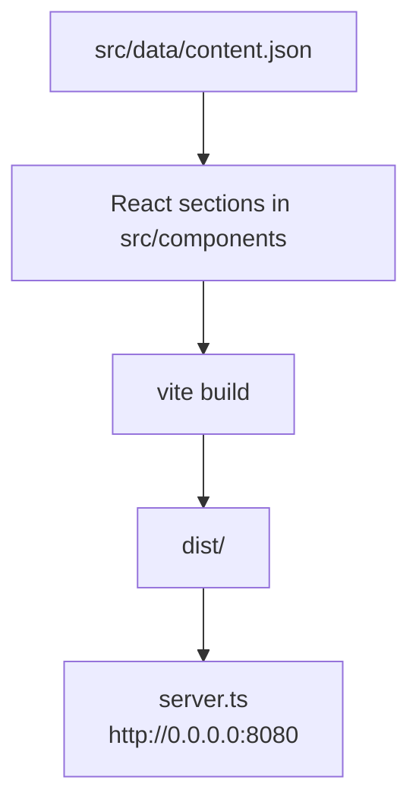

# Ornah Home

A single-page marketing site for Ornah Home, a personal organizer studio — copy, photos, and contact links driven by one JSON file.

## Overview

The site presents the studio, its services, product offerings, and brand partners, then sends quote requests to WhatsApp. It is a static React page: there is no application API and no form backend.

Almost all visitor-facing text lives in `src/data/content.json` — the brand name and tagline, navigation, hero and about copy, the founder profile, services, products, partner names, contact details, and footer labels. Components read that file instead of hard-coding copy, so most content edits do not require changing JSX.

Quote buttons (`CtaOrcamento`) open a WhatsApp chat (`https://wa.me/...`) in a new tab, with the message defined in `content.hero.mensagem_whatsapp`. The footer (`#contato`) also links to the phone, email, and Instagram values from `content.contato`.

The page is in Portuguese (`lang="pt-BR"`). Sections include a skip link to the main content, visible focus styles, and `prefers-reduced-motion` support for smooth scrolling.

## Tech stack

- React 19 and Vite 8
- Tailwind CSS 4 (`@tailwindcss/vite`), with theme tokens in `src/index.css` (forest, gold, paper; Montserrat and Bodoni Moda)
- `lucide-react` for icons
- A small Node.js HTTP server in `server.ts` that serves the production `dist/` folder
- oxlint for linting (`npm run lint`)

`vite.config.js` sets `base: './'` so the built assets work both at a domain root and under a subdirectory. There are no environment variables and no automated tests in this repository.

## Page structure



`App.jsx` renders, in order:

1. **Navbar** — fixed header, desktop links, mobile menu, WhatsApp CTA
2. **Hero** (`#inicio`)
3. **About** (`#sobre`), including the founder block
4. **Services** (`#servicos`)
5. **Products** (`#produtos`)
6. **Partners** (`#parcerias`) — logo strip; not listed in the main nav
7. **Footer** (`#contato`) — phone, email, Instagram, and another CTA

Photos under `public/fotos/` and partner marks under `public/parcerias/` are served as static files. A few service and product images in `content.json` point at remote Unsplash URLs instead of local files.

## How to run locally

```bash
npm install
npm run dev
```

That starts the Vite dev server. For a production-like run, build the static assets and start the Node server:

```bash
npm run build
npm run start
```

`npm run start` is `node --experimental-strip-types server.ts`. That flag needs a recent Node.js release (Node 22 or newer). The server listens on `0.0.0.0:8080` and only accepts `GET` and `HEAD`. If `dist/index.html` is missing, it responds with `503` and asks you to run `npm run build` first. Paths are resolved inside `dist/` only; unknown extension-less paths fall back to `index.html`.

Other scripts:

```bash
npm run preview   # Vite preview of the production build
npm run lint      # oxlint
```

## Project structure

```
.
├── index.html
├── package.json
├── vite.config.js
├── server.ts                 # Static file server for dist/ on port 8080
├── discloud.config           # Discloud site: build with npm run build, start with npm run start
├── public/
│   ├── favicon.svg
│   ├── fotos/                # Local photography used by the page
│   └── parcerias/            # Partner logo images
└── src/
    ├── main.jsx
    ├── App.jsx
    ├── index.css
    ├── data/content.json     # All site copy and contact fields
    ├── lib/contato.js        # Phone, WhatsApp, and Instagram URL helpers
    └── components/           # Navbar, Hero, About, Services, Products, Partners, Footer, ...
```

## Deployment notes

`discloud.config` describes a site named `ornahhome`: `TYPE=site`, `RAM=512`, `BUILD=npm run build`, `START=npm run start`, `MAIN=server.ts`, `VERSION=latest`. The listen port in `server.ts` is fixed at `8080` (it does not read a `PORT` environment variable).
